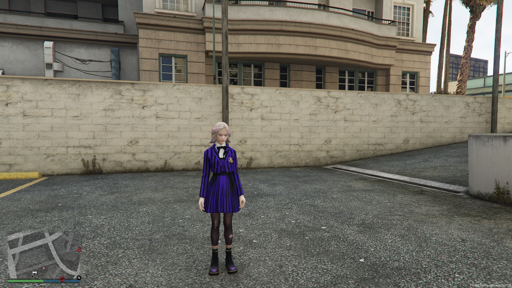
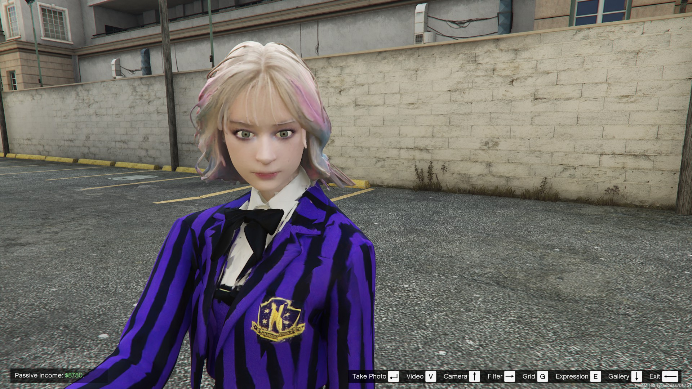
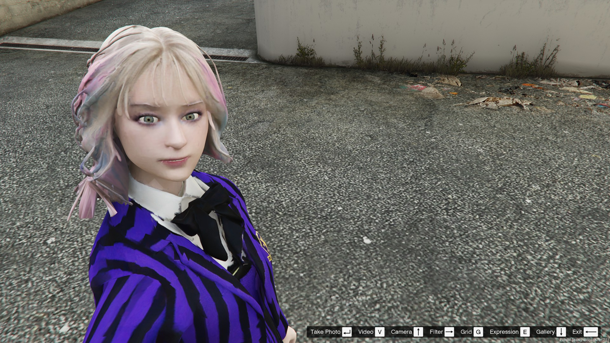

# Enid Sinclair – FiveM ped

A custom ped of Enid Sinclair from *Wednesday* (Netflix), in her purple-striped Nevermore Academy uniform. It replaces the base-game model `a_f_y_hipster_01`.



| Close-up | Side view |
|---|---|
|  |  |

## Versions

The package holds two heights, each built for both game generations. That makes four ready-to-use FiveM resources.

| Folder | Height | Game build | Stream folder |
|---|---|---|---|
| `default_height/gen8_legacy` | ~190 cm | Gen 8 – GTA V Legacy | `stream/` |
| `default_height/gen9_enhanced` | ~190 cm | Gen 9 – GTA V Enhanced | `stream_enhanced/` |
| `160cm/gen8_legacy` | 160 cm | Gen 8 – GTA V Legacy | `stream/` |
| `160cm/gen9_enhanced` | 160 cm | Gen 9 – GTA V Enhanced | `stream_enhanced/` |

The 160 cm version is the same model, scaled uniformly.

## Installation

1. Pick **one** of the four resources:
   - Choose by height.
   - Choose by game build: **Gen 8** for a standard/Legacy FiveM server, **Gen 9** for a GTA V Enhanced server.
2. Copy that folder into your server's `resources` folder and rename it, e.g. to `enid_sinclair`.
3. Add it to `server.cfg`:
   ```
   ensure enid_sinclair
   ```
4. Restart the server, or run `refresh` and `ensure enid_sinclair` in the server console.
5. Join the server and type **`/enid`** in chat (F8 console also works) to switch into the model.

## Important

- **Run only one resource at a time.** All four versions replace the same model (`a_f_y_hipster_01`), so running two of them at once makes them conflict.
- **Match the edition to your server.** Gen 9 files don't load on a Legacy server, and Gen 8 files don't load on an Enhanced server.
- **Replaced NPCs:** `a_f_y_hipster_01` is a common street ped, so you will see Enid walking around the city as a random NPC.
- **Stale look after an update:** if the old look still shows, clear the FiveM cache (`FiveM Application Data\data\cache`) and reconnect.

## Contents

```
Enid Sinclair/
├─ Blender/Enid_Perfect_Base_2.blend   Blender source file
├─ Meshy_AI_reference_image.png        reference image used for Meshy AI
├─ Screenshots/                        in-game screenshots
├─ default_height/                     gen8_legacy, gen9_enhanced
└─ 160cm/                              gen8_legacy, gen9_enhanced
```

Each resource contains:

```
<resource>/
├─ fxmanifest.lua       resource manifest
├─ client.lua           /enid command (loads and applies the model)
└─ stream/ or stream_enhanced/
   ├─ a_f_y_hipster_01.ydd   model (head, top, legs)
   ├─ a_f_y_hipster_01.yft   skeleton
   ├─ a_f_y_hipster_01.ytd   textures
   └─ a_f_y_hipster_01.ymt   ped component metadata
```

## Notes

- Rigged to the standard GTA V ped skeleton, so all normal animations work.
- Generated with Meshy AI, then rigged and exported in Blender 5.2 (Muto Ped Rig + Sollumz) with Claude Opus 5.5 through Blender MCP.
