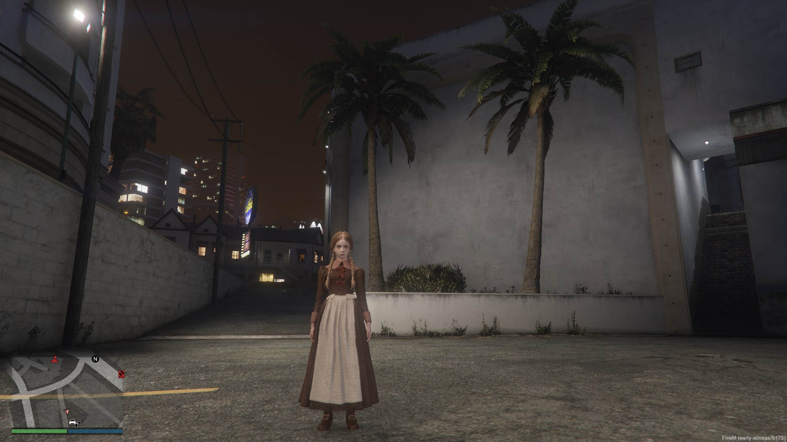
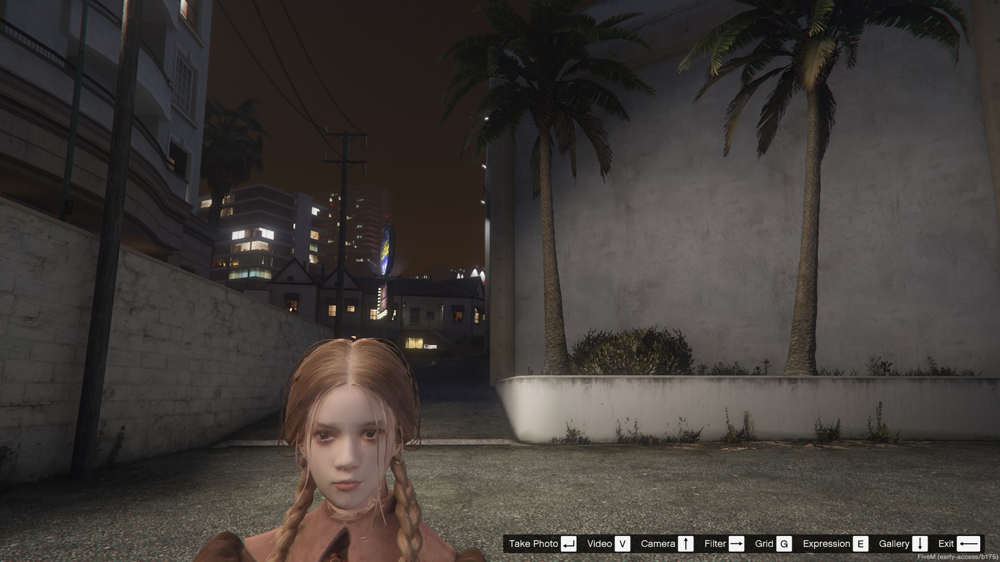
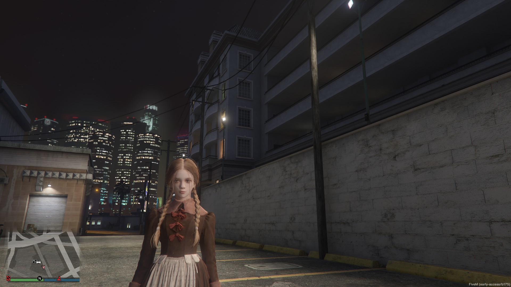

# Goody Addams – FiveM ped

A custom ped of Goody Addams from *Wednesday* (Netflix), in her brown colonial dress with a white apron and braided hair.

This is an **add-on ped**: it adds a new model, `goody_addams`, through `peds.meta` and does not replace any base-game ped. No random NPCs will look like her.



| Close-up | Upper body |
|---|---|
|  |  |

## Versions

| Folder | Height | Game build | Stream folder |
|---|---|---|---|
| `default_height/gen9_enhanced` | default (unscaled) | Gen 9 – GTA V Enhanced | `stream/` |
| `155cm/gen9_enhanced` | 155 cm | Gen 9 – GTA V Enhanced | `stream_enhanced/` |

The 155 cm version is the same model, scaled uniformly. There is no Gen 8 (Legacy) build yet.

## Installation

1. Pick **one** of the two resources, by height.
2. Copy that folder into your server's `resources` folder and rename it, e.g. to `goody_addams`.
3. Add it to `server.cfg`:
   ```
   ensure goody_addams
   ```
4. Restart the server, or run `refresh` and `ensure goody_addams` in the server console.
5. Join the server and type **`/goody_addams`** in chat (F8 console also works) to switch into the model.

Because it's an add-on ped, you can also spawn it from other scripts or menus by its model name, `goody_addams`.

## Important

- **Run only one resource at a time.** Both versions register the same model name (`goody_addams`), so running both makes them conflict.
- **Gen 9 only.** These files need a GTA V Enhanced server.
- **Stale look after an update:** if the old look still shows, clear the FiveM cache (`FiveM Application Data\data\cache`) and reconnect.

## Contents

```
Goody Addams/
├─ Screenshots/          in-game screenshots
├─ default_height/gen9_enhanced/
└─ 155cm/gen9_enhanced/
```

Each resource contains:

```
<resource>/
├─ fxmanifest.lua       resource manifest
├─ client.lua           /goody_addams command (loads and applies the model)
├─ peds.meta            registers the goody_addams add-on model
└─ stream/ or stream_enhanced/
   ├─ goody_addams.ydd  model (head, top, legs)
   ├─ goody_addams.yft  skeleton
   ├─ goody_addams.ytd  textures
   └─ goody_addams.ymt  ped component metadata
```

## Notes

- Rigged to the standard GTA V ped skeleton, so all normal animations work.
- Generated with Meshy AI, then rigged and exported in Blender 5.2 (Muto Ped Rig + Sollumz) with Claude Opus 5.5 through Blender MCP.
