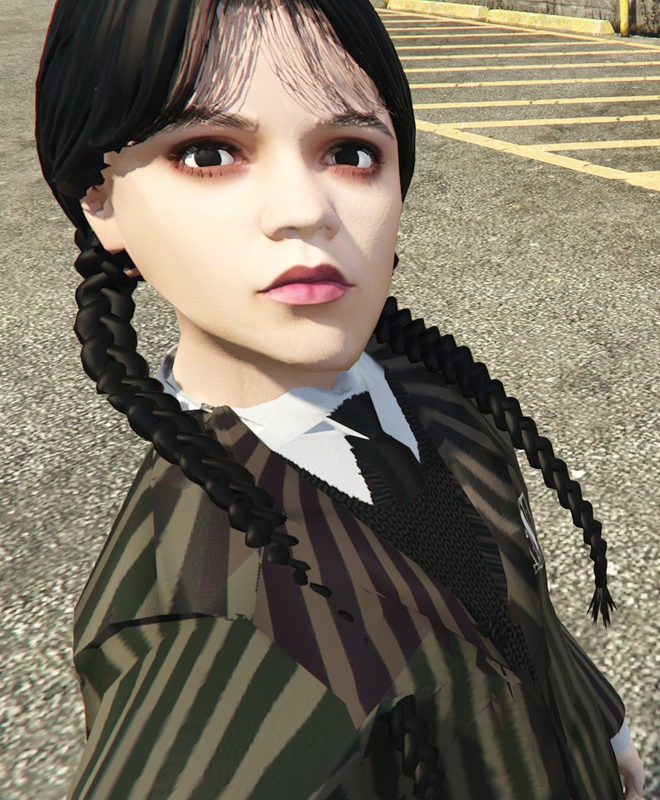

# Wednesday Addams – FiveM ped

A custom ped of Wednesday Addams from *Wednesday* (Netflix), in her black-and-grey striped Nevermore Academy uniform with her signature braids. It replaces the base-game model `u_f_y_poppymich`.



| Front | Front (closer) | Back |
|---|---|---|
|  |  |  |

## Versions

The package holds two heights, each built for both game generations. That makes four ready-to-use FiveM resources.

| Folder | Height | Game build | Stream folder |
|---|---|---|---|
| `default_height/gen8_legacy` | ~192 cm | Gen 8 – GTA V Legacy | `stream/` |
| `default_height/gen9_enhanced` | ~192 cm | Gen 9 – GTA V Enhanced | `stream_enhanced/` |
| `155cm/gen8_legacy` | 155 cm | Gen 8 – GTA V Legacy | `stream/` |
| `155cm/gen9_enhanced` | 155 cm | Gen 9 – GTA V Enhanced | `stream_enhanced/` |

The 155 cm version is the same model, scaled uniformly. It's closer to the character's real height.

## Installation

1. Pick **one** of the four resources:
   - Choose by height.
   - Choose by game build: **Gen 8** for a standard/Legacy FiveM server, **Gen 9** for a GTA V Enhanced server.
2. Copy that folder into your server's `resources` folder and rename it, e.g. to `wednesday_addams`.
3. Add it to `server.cfg`:
   ```
   ensure wednesday_addams
   ```
4. Restart the server, or run `refresh` and `ensure wednesday_addams` in the server console.
5. Join the server and type **`/wednesday_addams`** in chat (F8 console also works) to switch into the model.

## Important

- **Run only one resource at a time.** All four versions replace the same model (`u_f_y_poppymich`), so running two of them at once makes them conflict. The same goes for any other `u_f_y_poppymich` replacement.
- **Match the edition to your server.** Gen 9 files don't load on a Legacy server, and Gen 8 files don't load on an Enhanced server.
- **Replaced NPC:** `u_f_y_poppymich` is the story-mode character Poppy Mitchell. Anywhere the game spawns her, she will appear as Wednesday instead.
- **Stale look after an update:** if the old look still shows, clear the FiveM cache (`FiveM Application Data\data\cache`) and reconnect.

## Contents

```
Wednesday Addams/
├─ Screenshots/        in-game screenshots
├─ default_height/     gen8_legacy, gen9_enhanced
└─ 155cm/              gen8_legacy, gen9_enhanced
```

Each resource contains:

```
<resource>/
├─ fxmanifest.lua       resource manifest
├─ client.lua           /wednesday_addams command (loads and applies the model)
└─ stream/ or stream_enhanced/
   ├─ u_f_y_poppymich.ydd   model (head, top, legs)
   ├─ u_f_y_poppymich.yft   skeleton
   ├─ u_f_y_poppymich.ytd   textures
   └─ u_f_y_poppymich.ymt   ped component metadata
```

## Notes

- Rigged to the standard GTA V ped skeleton, so all normal animations work.
- Generated with Meshy AI, then rigged and exported in Blender 5.2 (Muto Ped Rig + Sollumz) with Claude Opus 5.5 through Blender MCP.
