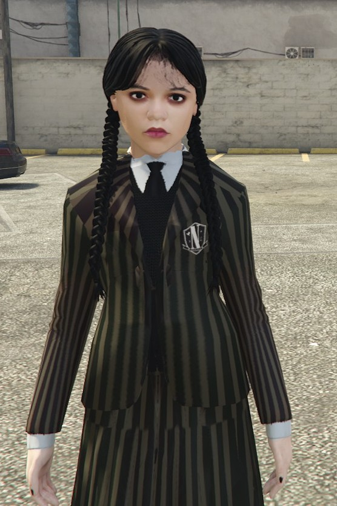
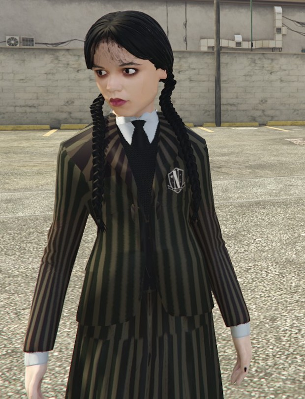
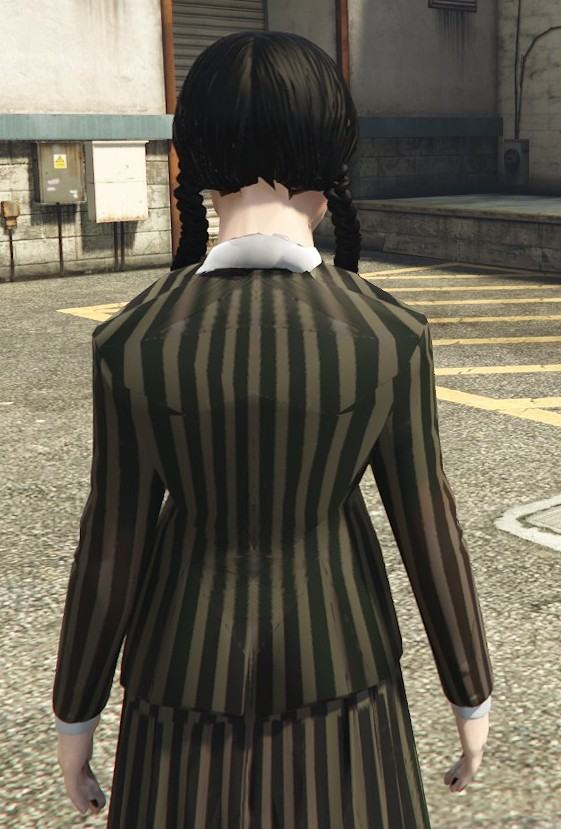
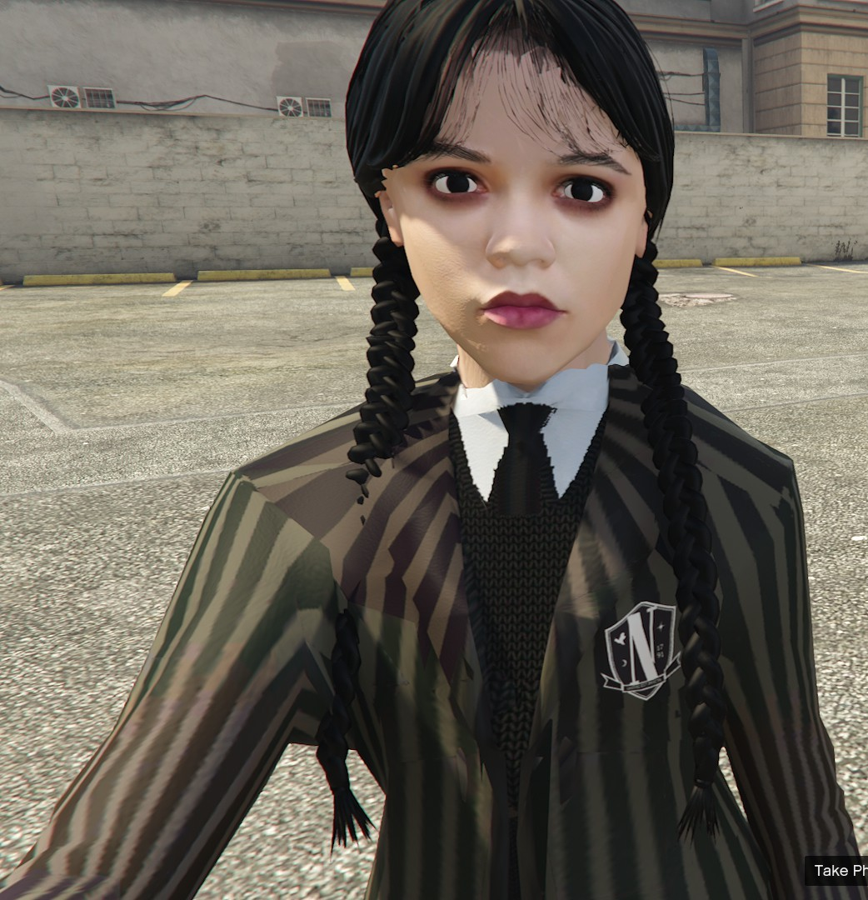

# Wednesday Addams – FiveM ped

A custom ped of Wednesday Addams from *Wednesday* (Netflix), in her black-and-grey striped Nevermore Academy uniform with her signature braids. It replaces the base-game model `u_f_y_poppymich`.



| Three-quarter view | Back | Close-up | Face |
|---|---|---|---|
|  |  |  |  |

## Versions

| Folder | Height | Game build | Stream folder |
|---|---|---|---|
| `default_height/gen9_enhanced` | default (unscaled) | Gen 9 – GTA V Enhanced | `stream_enhanced/` |

There is no Gen 8 (Legacy) build or scaled-height version of this release yet.

## Installation

1. Copy the `default_height/gen9_enhanced` folder into your server's `resources` folder and rename it, e.g. to `wednesday_addams`.
2. Add it to `server.cfg`:
   ```
   ensure wednesday_addams
   ```
3. Restart the server, or run `refresh` and `ensure wednesday_addams` in the server console.
4. Join the server and type **`/wednesday_addams`** in chat (F8 console also works) to switch into the model.

## Important

- **Gen 9 only.** These files need a GTA V Enhanced server.
- **Replaced NPC:** `u_f_y_poppymich` is the story-mode character Poppy Mitchell. Anywhere the game spawns her, she will appear as Wednesday instead.
- **Don't run it alongside another `u_f_y_poppymich` replacement**, or the two will conflict.
- **Stale look after an update:** if the old look still shows, clear the FiveM cache (`FiveM Application Data\data\cache`) and reconnect.

## Contents

```
Wednesday Addams/
├─ Screenshots/                    in-game screenshots
└─ default_height/gen9_enhanced/
   ├─ fxmanifest.lua               resource manifest
   ├─ client.lua                   /wednesday_addams command (loads and applies the model)
   └─ stream_enhanced/
      ├─ u_f_y_poppymich.ydd       model (head, top, legs)
      ├─ u_f_y_poppymich.yft       skeleton
      ├─ u_f_y_poppymich.ytd       textures
      └─ u_f_y_poppymich.ymt       ped component metadata
```

## Notes

- Rigged to the standard GTA V ped skeleton, so all normal animations work.
- Generated with Meshy AI, then rigged and exported in Blender 5.2 (Muto Ped Rig + Sollumz) with Claude Opus 5.5 through Blender MCP.
